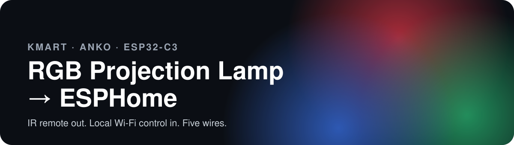
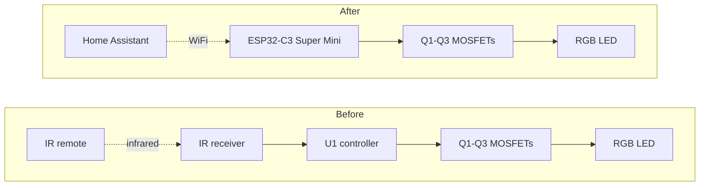
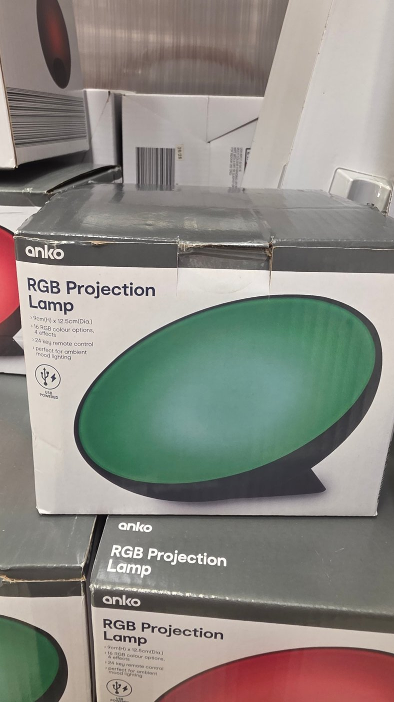
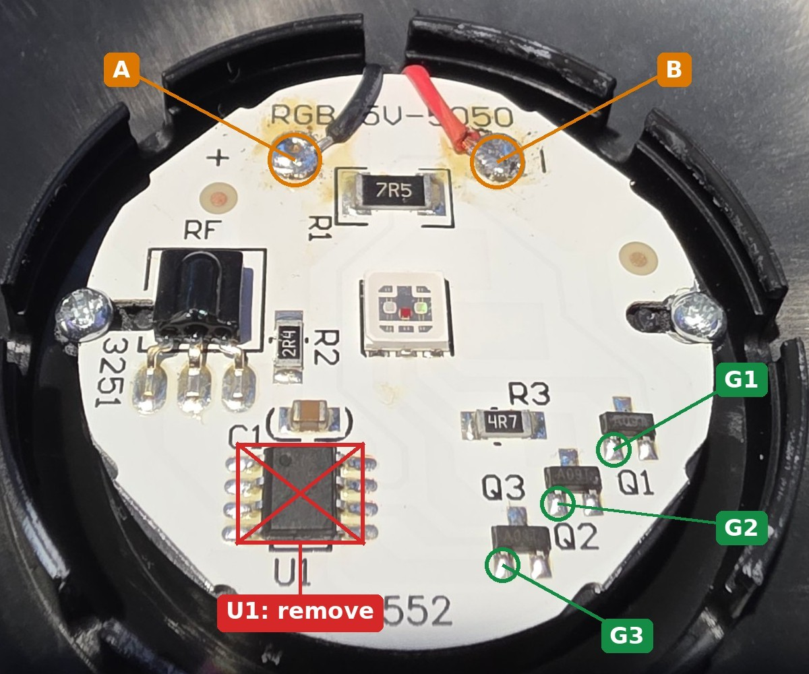
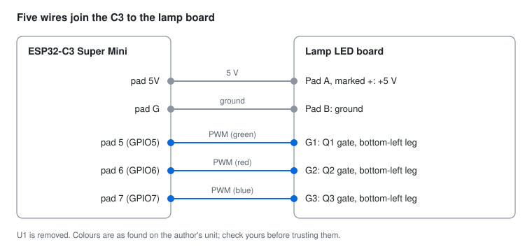
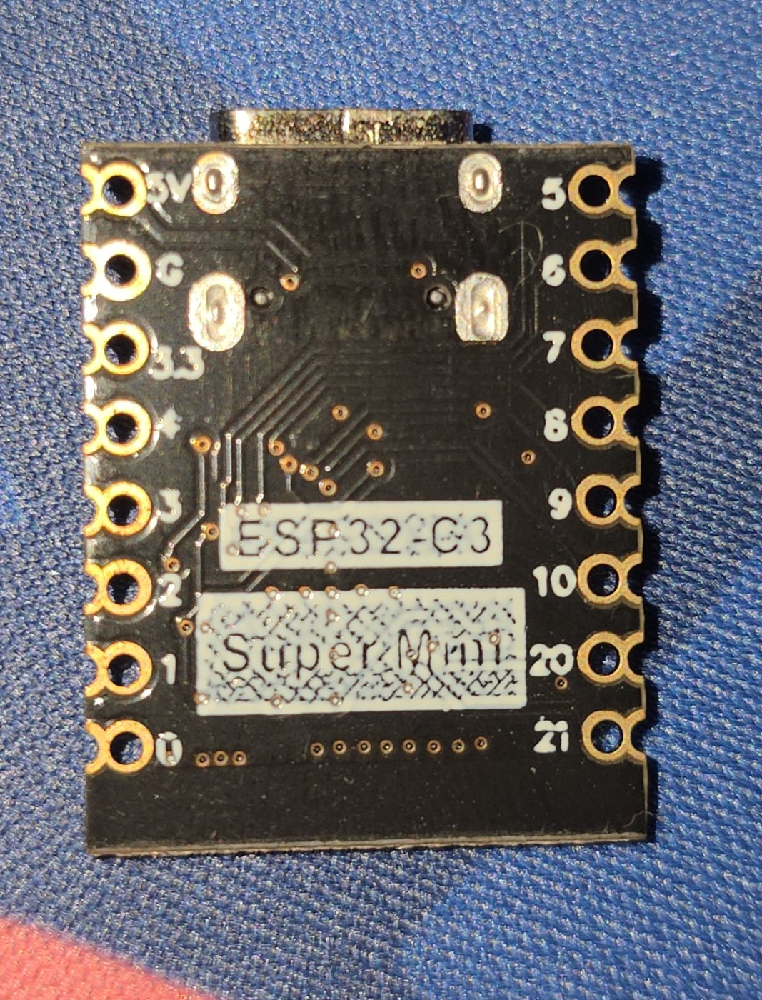
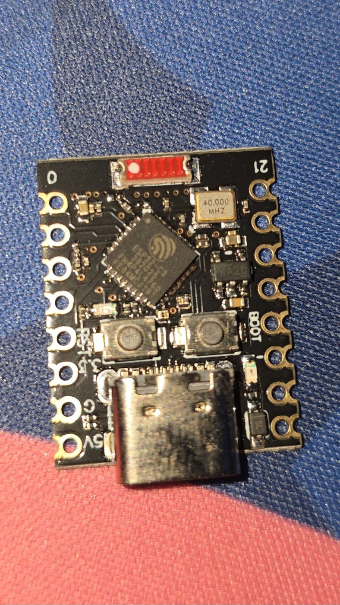

<p align="center">
  
</p>

<p align="center">
  <a href="https://github.com/ImStillBlue/kmart-projection-lamp-esphome/actions/workflows/validate.yml"></a>
  <a href="https://esphome.io"></a>
  <a href="https://www.home-assistant.io"></a>
  
  
  <a href="LICENSE"></a>
</p>

<p align="center">
  Convert the Kmart (Anko) <b>RGB Projection Lamp</b> from its IR remote to local Wi-Fi control<br>
  with <a href="https://esphome.io">ESPHome</a> and an <b>ESP32-C3 Super Mini</b>. Five wires, one chip removed, no cloud.
</p>

<p align="center">
  <a href="#wiring">Wiring</a> ·
  <a href="#build-steps">Build steps</a> ·
  <a href="#esphome-config">Config</a> ·
  <a href="#troubleshooting">Troubleshooting</a> ·
  <a href="#faq">FAQ</a>
</p>

---

## Overview

The lamp is already a three-channel PWM dimmer. An unmarked 8-pin chip (U1)
reads the IR remote and switches three MOSFETs, one per colour of a single 5 V
RGB LED. This mod removes U1 and lets an ESP32-C3 drive those same MOSFET
gates, powered from the lamp's own USB lead.



**Status:** built and working on one lamp, controlled from Home Assistant.
The config compiles on ESPHome 2026.11.0.

| | Stock | After this mod |
| --- | --- | --- |
| Control | 24-key IR remote | Home Assistant / ESPHome API over Wi-Fi |
| Colours | 16 presets | Any RGB colour |
| Effects | 4 built in | 8 in the config; add your own |
| Dimming | Remote steps | 14-bit PWM with smooth transitions |
| Automations | No | Yes |
| Firmware updates | No | Wireless (OTA) |

<table>
  <tr>
    <th>The lamp</th>
    <th>Its LED board, with the solder points</th>
  </tr>
  <tr>
    <td></td>
    <td></td>
  </tr>
</table>

<p align="center"><sub>The same board <a href="images/lamp-board.jpg">without the markings</a>, for comparing against yours.</sub></p>

## Contents

- [What is on the lamp board](#what-is-on-the-lamp-board)
- [Parts and tools](#parts-and-tools)
- [Wiring](#wiring)
- [Build steps](#build-steps)
- [ESPHome config](#esphome-config)
- [First power-up](#first-power-up)
- [Troubleshooting](#troubleshooting)
- [FAQ](#faq)
- [Contributing](#contributing)
- [References](#references)
- [License](#license)

## What is on the lamp board

| Part | What it is | What happens to it |
| --- | --- | --- |
| Two large pads with the USB wires | 5 V supply in | Keep (see the polarity warning) |
| Q1, Q2, Q3 (SOT-23, marked `A09T`) | [AO3400A](https://www.aosmd.com/res/datasheets/AO3400A.pdf) N-channel logic-level MOSFETs, one per colour | Keep. Their gates are the three signal points |
| U1 (8-pin, unmarked) | Original IR controller | Remove |
| "RF" 3-pin black part | IR receiver (not radio, despite the label) | Leave in place, unused |
| R1 `7R5`, R2 `2R4`, R3 `4R7` | Current-limiting resistors | Keep |
| Centre square part | 5050 RGB LED | Keep |

The AO3400A switches fully on from a 3.3 V GPIO (gate threshold 1.45 V max),
so no level shifter is needed.

All three MOSFETs sit the same way up. With the single leg at the top, the
**bottom-left leg is the gate** and the bottom-right leg is the source (ground).

> [!WARNING]
> **Do not trust the wire colours.** On my lamp they are reversed: the
> **black** wire is +5 V and the **red** wire is ground. The `+` silkscreen on
> the board is correct. Go by the silkscreen and a multimeter. Reversed 5 V
> will kill the C3.

> [!CAUTION]
> Never drive the LED straight from GPIO pins. The resistor values point to a
> few hundred milliamps per colour; the C3 only ever drives the MOSFET gates.

## Parts and tools

| Parts | Tools |
| --- | --- |
| ESP32-C3 Super Mini, without pin headers | Fine-tip soldering iron and flux |
| Thin stranded wire (28–30 AWG), 5 × about 8 cm | Solder wick (hot air helps for U1) |
| 3 × 10 kΩ resistors for pull-downs (optional, recommended) | Multimeter |
| Heat-shrink or Kapton tape | Flush cutters, tweezers |
| 5 V USB supply, 1 A or more | USB-C data cable for the first flash |

## Wiring

<p align="center">
  
</p>

| Wire | Lamp board point | C3 pad | Purpose |
| :---: | --- | :---: | --- |
| 1 | Pad A, marked `+` | `5V` | Powers the C3 |
| 2 | Pad B | `G` | Common ground |
| 3 | G1: Q1 gate | `5` | PWM (green on my unit) |
| 4 | G2: Q2 gate | `6` | PWM (red on my unit) |
| 5 | G3: Q3 gate | `7` | PWM (blue on my unit) |

Pads 5, 6 and 7 are adjacent and have no boot-time role. Avoid pads 2, 8 and 9
(strapping pins; 8 is the onboard LED, 9 the BOOT button) and 20 and 21
(serial).

> [!TIP]
> Once U1 is off, three of its empty pads connect straight to the three gates.
> Find them with a continuity test if the MOSFET legs feel too small to solder.

> [!TIP]
> A 10 kΩ pull-down from each gate wire to ground holds the LED off while the
> C3 boots or reflashes.

<p align="center">
  
  &nbsp;&nbsp;
  
</p>

## Build steps

1. **Flash the C3 first, on the desk.** See [ESPHome config](#esphome-config).
   Confirm it comes online over Wi-Fi, then unplug it.
2. **Unplug the lamp** and open it up to reach the round LED board.
3. **Confirm polarity** with a multimeter across the two supply pads.
4. **Disconnect U1 from the gates.** Any of these works:
   - desolder it (hot air, or flood both rows with solder and slide it off);
   - cut all eight legs at the chip body and lift it away;
   - lift only the three legs that connect to the gates.

   Cutting only U1's power leg is not enough.
5. **Identify the colours (optional).** With the lamp powered, hold a 1–10 kΩ
   resistor from the +5 V pad to each gate in turn; each lights one colour. A
   colour can stay lit until you touch the resistor from that gate to ground.
   Use a resistor, not a bare wire: a slip onto the neighbouring leg would
   short the supply.
6. **Solder the C3 end:** pads `5V`, `G`, `5`, `6`, `7`. Fit pull-downs now.
7. **Solder the lamp end.** Tin the wire, tin the leg, touch them together
   briefly.
8. **Check for shorts** between neighbouring MOSFET legs and from each gate to
   +5 V.
9. **Wrap the C3** in heat-shrink or Kapton. Keep the ceramic antenna clear of
   the wires, and cover the C3's red power LED so it does not glow inside the
   lamp.
10. **Dry-fit, then reassemble.**

> [!CAUTION]
> Never plug the C3's USB-C into a computer while the lamp's own USB lead is
> powered. The two 5 V supplies end up tied together.

## ESPHome config

The full config is [`projection-lamp.yaml`](projection-lamp.yaml).

```bash
cp secrets.yaml.example secrets.yaml   # then fill in your Wi-Fi details and keys
esphome run projection-lamp.yaml       # first flash over USB-C
```

Or paste the YAML into ESPHome Device Builder and install from there. If the
serial port does not appear, hold BOOT while plugging the C3 in.

What the config exposes:

| Entity | Type | Notes |
| --- | --- | --- |
| Projection Lamp | RGB light | Colour, brightness, 400 ms default transition, off after power loss by default |
| WiFi Signal | Sensor | Diagnostic |
| Restart | Button | |

| Effect | What it does |
| --- | --- |
| Colour Cycle | Smooth sweep around the colour wheel |
| Purple Blue Drift | Slow fade through purples and blues |
| Ocean Drift | Slow fade through blues and aqua |
| Sunset Drift | Slow fade through orange, pink and purple |
| Slow Random | Drifts to a new random colour every few seconds |
| Breathe | Slow pulse of the current colour |
| Strobe | On/off flash |
| Candle | Gentle flicker |

To make your own drift, copy one of the `Drift` effects in the YAML, give it a
new name and change the colours in its `palette` list (0-255 RGB, as many as
you like). Keep `update_interval` and `set_transition_length` equal so the
fades run back to back. Shorter values make it faster.

<details>
<summary><b>Pin mapping and PWM settings</b></summary>

<br>

```yaml
substitutions:
  pin_red: GPIO6
  pin_green: GPIO5
  pin_blue: GPIO7

output:
  - platform: ledc
    id: out_red
    pin: ${pin_red}
    frequency: 4882 Hz   # fastest setting that keeps the C3's full 14-bit depth
```

`wifi: output_power: 8.5dB` is set on purpose: many Super Mini boards connect
more reliably at reduced transmit power. Raise or remove it if range is poor.

</details>

## First power-up

1. The lamp stays dark at plug-in; that is the configured default.
2. Home Assistant should discover "Projection Lamp" under the ESPHome
   integration. Add it with your API key.
3. Set pure red, then green, then blue. If a colour is wrong, swap the
   `pin_red` / `pin_green` / `pin_blue` values in `substitutions` and install
   wirelessly. Mine came up with red and green swapped; the committed config
   has the corrected order for my unit.
4. If white looks tinted, add `max_power: 80%` (adjust to taste) under the
   strong colour's `ledc` output.

## Troubleshooting

| Symptom | Likely cause | Fix |
| --- | --- | --- |
| LED flashes or glows at plug-in or during an update | Gates float while the C3 boots | Fit the 10 kΩ pull-downs |
| Never joins Wi-Fi, or drops out | Weak antenna on some Super Mini boards | Keep `output_power: 8.5dB`; move the antenna clear of wires; raise it in steps if range is the problem |
| Cannot reach it at all | Wrong Wi-Fi details | Join the "Projection Lamp Fallback" hotspot and re-enter them |
| Resets at full-brightness white | 5 V sags under LED load | 2 A supply, short lead, or a 470 µF capacitor across `5V` and `G` |
| One colour stuck on | Solder bridge on U1's pads or MOSFET legs | Inspect and wick |
| One colour never lights | Dry joint or wrong leg | Reflow; the gate is bottom-left with the single leg up |
| Faint red glow when off | The C3's own power LED | Cover it |

## FAQ

<details>
<summary><b>Do I have to remove U1?</b></summary>

<br>

Its three outputs have to come off the gates, but the chip itself does not
have to leave the board. If U1 stays connected, it and the C3 both drive the
same gate lines and fight each other. Cutting its legs or lifting the three
output legs is enough. Cutting only its power leg is not: an unpowered chip
still loads the gate lines.

</details>

<details>
<summary><b>Can I keep the IR remote working?</b></summary>

<br>

Not with this config. The IR receiver is left on the board, so you could wire
its output to a spare pad (for example `4`) and decode the remote with
ESPHome's `remote_receiver`. That is untested here.

</details>

<details>
<summary><b>Will this work on a different board revision?</b></summary>

<br>

Unknown. This was done on one lamp. Compare your board with the
[unmarked photo](images/lamp-board.jpg) before soldering. If it differs, or if
you finish the mod on yours, a
[board report](https://github.com/ImStillBlue/kmart-projection-lamp-esphome/issues/new?template=board-report.yml)
with a photo is welcome.

</details>

<details>
<summary><b>Why these three pads on the C3?</b></summary>

<br>

5, 6 and 7 sit next to each other and have no boot-time role. Pads 2, 8 and 9
are strapping pins, and 20 and 21 are the serial port.

</details>

## Repository layout

```
.
├── projection-lamp.yaml     ESPHome config
├── secrets.yaml.example     Template for your secrets.yaml (git-ignored)
├── images/                  Photos, wiring diagram, banner
├── .github/
│   ├── workflows/           CI: validates and compiles the config
│   └── ISSUE_TEMPLATE/      Board report and problem forms
├── CONTRIBUTING.md
├── LICENSE
└── README.md
```

## Contributing

This guide comes from a single lamp, so reports from other units are the most
useful contribution: open a
[board report](https://github.com/ImStillBlue/kmart-projection-lamp-esphome/issues/new?template=board-report.yml)
with a photo of your board. Fixes and new effects are welcome as pull
requests; see [CONTRIBUTING.md](CONTRIBUTING.md). Every change to the config
is validated and compiled by
[GitHub Actions](https://github.com/ImStillBlue/kmart-projection-lamp-esphome/actions/workflows/validate.yml).

## References

- [AO3400A datasheet](https://www.aosmd.com/res/datasheets/AO3400A.pdf), Alpha & Omega Semiconductor
- [Getting Started with the ESP32-C3 Super Mini](https://randomnerdtutorials.com/getting-started-esp32-c3-super-mini), Random Nerd Tutorials
- [ESP32 LEDC Output](https://esphome.io/components/output/ledc/), ESPHome
- [ESP32-C3 Super Mini WiFi connection problem](https://community.home-assistant.io/t/esp32-c3-super-mini-wifi-connection-problem/785228/15), Home Assistant Community

## License

[MIT](LICENSE). Use it, change it, share it.

The lamp runs on 5 V USB, but opening and modifying it voids any warranty and
is done at your own risk. Not affiliated with Kmart or Anko.
